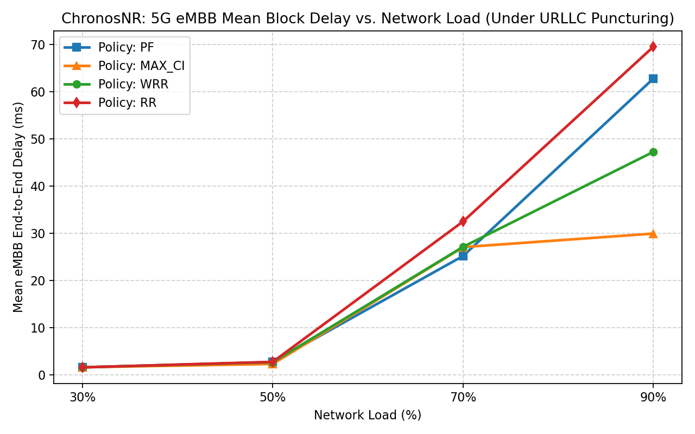
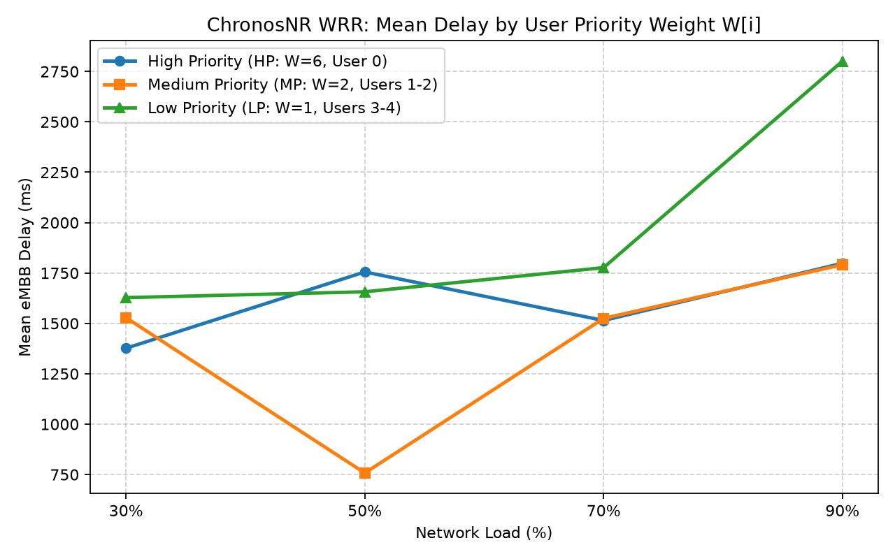
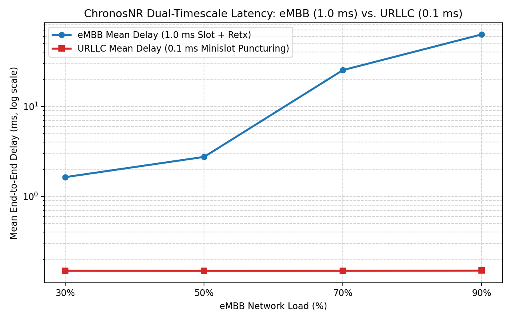

# ChronosNR

ChronosNR is an OMNeT++ simulation framework modeling dual-timescale scheduling and multiplexing in 5G NR:
- **eMBB (Enhanced Mobile Broadband)**: 1.0 ms slot allocation via policies such as WRR (Weighted Round Robin), PF (Proportional Fair), MAX_CI, and RR.
- **URLLC (Ultra-Reliable Low-Latency Communication)**: 0.1 ms mini-slot allocation with dynamic puncturing over ongoing eMBB transmissions.

---

## Architecture Overview

```
====================================================================================================
                             ChronosNRNetwork (ChronosNRNetwork.ned)
====================================================================================================

  +----------------------------------------------------+
  |               embbScheduler (1.0 ms)               |  [Defined in: SchedulersAndSink.cc]
  |  - Reads queue lengths via ChronosNRModules.h      |  - Runs at Priority 2 every 1.0 ms
  |  - Serves highPrioRetxQueue FIRST                  |  - Policies: WRR (W=6,2,1), PF, MAX_CI, RR
  +----------------------------------------------------+
                            |
                            | SchedGrant (assignedPrb = b) [ChronosNRMsg.msg]
                            v
  +----------------------------------------------------+
  |         embbUser[0..4] (Compound Module)           |  [Defined in: UserModules.cc]
  |                                                    |
  |  +-------------------+    +---------------------+  |     1. Pops block from highPrioRetxQueue
  |  |        gen        |--->|       buffer        |  |        (or waitingQueue)
  |  | (PacketGenerator) |    |  (EmbbUserBuffer)   |  |     2. Sends ONLY A COPY: origBlock->dup()
  |  +-------------------+    |                     |  |     3. Keeps original in keptQueue
  |                           |  - waitingQueue     |  |
  |                           |  - keptQueue        |  |======== eMBB_Copy ========+
  |                           |  - highPrioRetxQueue|  |                           |
  |                           +---------------------+  |                           |
  +----------------------------------^-----------------+                           |
                                     |                                             v
              PrbFeedback            |                            +--------------------------------+
     - ACK_INTACT: delete keptOrig   |                            |          prb[0..9]             |
     - NACK_OVERWRITTEN: move        +----------------------------|         (PrbChannel)           |
       keptOrig -> highPrioRetxQueue       (At 1.0 ms Slot End)   |   [Defined in: PrbChannel.cc]  |
                                                                  |                                |
  +----------------------------------------------------+          |  States in Qtenv GUI:          |
  |           urllcUser (Compound Module)              |          |  - GREEN : FREE                |
  |                                                    |          |  - BLUE  : eMBB_Copy active    |
  |  +-------------------+    +---------------------+  |          |  - CYAN  : FREE -> URLLC       |
  |  |        gen        |--->|       buffer        |  |          |  - RED   : PUNCTURED (xCount)  |
  |  | (PacketGenerator) |    | (UrllcQueueModule)  |  |          +--------------------------------+
  |  +-------------------+    +---------------------+  |                    ^              |
  +----------------------------------^-----------------+                    |              |
                                     |                     URLLC_Block      |              |
                            +--------+--------------------------------------+              |
                            |                                                              |
                            | SchedGrant (Free PRB first; else Uniform Random Puncture)    |
  +-------------------------+--------------------------+                                   |
  |              urllcScheduler (0.1 ms)               |  [Defined in: SchedulersAndSink.cc]
  |  - Wakes up every 0.1 ms minislot (Priority 4)     |                                   |
  |  - Scans prb[0..9] for FREE channel first          |                                   v
  |  - If all full: overwrites an eMBB-occupied PRB    |                     +--------------------+
  +----------------------------------------------------+                     |        sink        |
                                                                             |    (RadioSink)     |
                                                                             | [SchedulersAndSink]|
                                                                             +--------------------+
```

---

## Directory Structure

```
ChronosNR/
├── src/                                  # [C++ & NED Source Code]
│   ├── package.ned                       # Declares NED package "chronosnr.src"
│   ├── ChronosNRMsg.msg                  # Packet, Grant, and Feedback message definitions
│   ├── ChronosNRNetwork.ned              # Compound User modules, Schedulers, PRBs, Sink
│   ├── ChronosNRModules.h                # Shared C++ class interfaces
│   ├── PrbChannel.cc                     # Shared Radio Channel state machine (1ms / 0.1ms)
│   ├── UserModules.cc                    # Generators & 3-Queue Retention Buffers
│   └── SchedulersAndSink.cc              # EmbbScheduler, UrllcScheduler, RadioSink
│
├── simulations/                          # [Experiment Configs & Raw Telemetry]
│   ├── omnetpp.ini                       # Points to network = chronosnr.src.ChronosNRNetwork
│   └── results/                          # Output directory for simulation scalars/vectors (.sca, .vec)
│
├── scripts/                              # [Automation & Analytics]
│   └── plot_results.py                   # Reads simulations/results/*.sca -> writes docs/plots/*.png
│
├── docs/                                 # [Documentation & Visual Assets]
│   └── plots/                            # Auto-populated by scripts/plot_results.py
│       ├── plot1_delay_vs_load.png       # Chart 1: eMBB Delay vs. Load (WRR, PF, MAX_CI, RR)
│       ├── plot2_priority_weights.png    # Chart 2: WRR Delay by Priority Weight (W=6, 2, 1)
│       └── plot3_embb_vs_urllc.png       # Chart 3: Dual-Timescale Latency (1ms vs 0.1ms)
│
├── .gitignore                            # Ignores out/, Makefile, *_m.*, and raw telemetry
└── README.md                             # Documentation & architecture
```

---

## Analytics & Results

Once the simulations and plotting script are executed, generated figures are saved to `docs/plots/`:

### 1. eMBB Delay vs. Network Load


### 2. WRR Delay by User Priority Weight


### 3. Dual-Timescale Latency (eMBB vs. URLLC)


